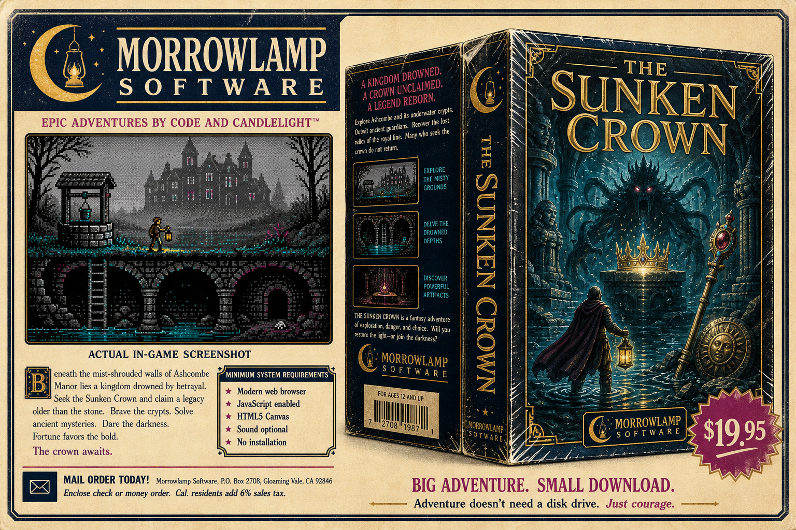

# MORROWLAMP GAME WORKSHOP



A tiny adventure-game factory. You assemble a **cartridge**, press **BUILD GAME**, and get
one self-contained HTML file that plays offline forever.

Plain HTML, plain CSS, plain JavaScript. No frameworks, no build step, no dependencies, and
**no runtime image or audio assets**: every scene is drawn pixel by pixel in code, and every
note is synthesized at runtime. A compiled adventure needs no server, no network and no
installation. Copy it to a USB stick, carry it thirty years, plug it into an offline machine,
double-click it, and play.

**The Sunken Crown is no longer the product.** Morrowlamp is the product. The Sunken Crown is
the first game made with it, and the conformance target that keeps the factory honest.

**Created and orchestrated by Christopher Davis.** See [CREDITS.md](CREDITS.md) for the
human-directed, multi-agent development methodology.

## Architecture

```
                        GAME CARTRIDGE                 js/cartridges/*.js
                              |
                              v
                     CARTRIDGE VALIDATOR              js/workshop/validator.js
                              |
                              v
                     MORROWLAMP MACHINE               js/morrowlamp/*.js
                   /          |          \
               WORLD        RULES     CAPABILITIES     score · treasures
              world.js     rules.js        |           darkness · light
                                           v           stats · combat
                                  OUTCOMES / ENCOUNTERS
                                           |
                                           v
                                        SHELLS
                        /                  |                \
                  index.html           text.html          compiler
                  publisher.js           ui.js       js/workshop/compiler.js
                  point-and-click       terminal              |
                                                              v
                                                    SINGLE HTML ADVENTURE
```

**Every one of those shells runs the same gameplay Machine over the same cartridge.** There
is one world model, one rule executor, one score system, one treasure system, one darkness
implementation, one character system, one encounter system and one save format. Fixing a
Sunken Crown bug in the cartridge fixes it in all three; `test/one-machine.js` exists to
make sure that stays true.

The Workshop (`author.html`) sits above all of this: it inspects cartridges, validates them,
and drives the compiler.

### The Machine, `js/morrowlamp/`

The reusable engine, and since consolidation the *only* gameplay implementation in the
project. It knows how to run **an** adventure and nothing about **any** adventure:
`test/workshop.js` fails the build if a word like "lantern" or "crown" appears in Machine
code, and there is no cartridge-id branching anywhere in it.

| File | What it owns |
| --- | --- |
| `core.js` | namespace, deep clone, event bus |
| `world.js` | rooms, exits, objects, containers, inventory, "where is that thing?" |
| `rules.js` | the declarative puzzle dialect |
| `vocabulary.js` | verbs, synonyms, noun resolution, ambiguity questions, fuzzy spelling |
| `profile.js` | optional capabilities: score, treasures, darkness, lamp fuel, turns, hunger, stats, combat, timers |
| `outcome.js` | what happens when a system fails or fires, death, encounter, move, end |
| `stats.js` | character stats, classes, growth and levels, all cartridge-defined |
| `encounter.js` | bounded exchanges that suspend play; combat is one kind |
| `runtime.js` | the turn loop, flags, scoring, save/load, undo, endings, `changed`/`refresh` reporting |
| `render.js` | display adapter selection over `js/gfx.js` |
| `sound.js` | sound hardware profiles over `js/audio.js` and `js/music.js` |
| `shell-canvas.js` | the hybrid interface: scene, hotspots, inventory, HUD, command line |
| `shell-parser.js` | the text interface, same cartridge, no canvas |

`js/gfx.js` is Machine too, dithering, palettes and pixel-safe scaling belong to every
Morrowlamp title.

### A cartridge, `js/cartridges/`

Everything specific to one game, declarative wherever practical: metadata, intro, world,
placement, vocabulary, rules, gameplay profile, endings, and presentation preferences
including its own procedural drawing routines.

Three ship in the box:

- **`sunken-crown.js`**: the full game. 18 scenes, 48 objects, 47 rules, six treasures,
  darkness, lamp oil, the sentinel, the echo, the mirror, the boat, the ending.
- **`captains-thistle.js`**: *CAPTAIN THISTLE AND THE VENDING MACHINE OF DOOM*, four rooms
  and one puzzle. It exists to prove the factory is a factory: same Machine, completely
  different game, its own scene painters, CGA instead of EGA, PC SPEAKER instead of a sound
  chip, no treasure system, no stats, no combat.
- **`sir-crumbly.js`**: *SIR CRUMBLY AND THE CELLAR RAT*, two rooms and one rat. It exists
  to prove the RPG layer is a capability and not The Sunken Crown in a false moustache: two
  stats called MIGHT and NERVE, one class, ten health, its own growth curve, one encounter,
  and the parser interface instead of the canvas.

### The rule dialect

```js
{
  id: 'dig-the-crack',
  verb: 'dig',                       // string or array
  target: [null, 'crack'],           // null means "the verb may stand alone"
  with: 'shovel',
  phrase: 'echo',                    // free text, for say/answer
  when: {
    room: 'cellar',
    carrying: ['shovel'],
    flags: { tunnelDug: false },
    open: { hatch: true },
    lit: { lantern: true },
    placed: ['crown']
  },
  do: [ { set: 'tunnelDug' }, { say: 'The crack opens…' }, { score: 5 } ],
  otherwise: [ { say: 'You need a shovel.' } ]
}
```

Rules are tried in order; the first that resolves wins; anything unclaimed falls through to
the Machine's own verbs. `@target`, `@with`, `@room` and `@player` resolve at execution time,
and `{the target}` expands in text.

Actions: `say` `set` `clear` `score` `goto` `give` `take` `drop` `destroy` `placeIn` `open`
`close` `unlock` `lock` `light` `douse` `refuel` `sound` `music` `die` `end` `describe` `stop`,
plus `encounter` `train` `heal` `hurt` `outcome` for cartridges that switch those capabilities on.

Both the action set and the condition set are **closed**: the validator rejects anything
outside them, so a typo is a build error rather than a puzzle that silently never fires.

### Capabilities

Optional systems are declared in `profile`. A capability is either `false`, or a
configuration object that switches it on:

```js
profile: {
  score:     { treasureFound: 5, ranks: [[0, 'Wandering Stranger'], …] },
  treasures: { list: [...], securedIn: 'cabinet' },
  darkness:  { grace: 1, onFail: { type: 'encounter', encounter: 'umbra' } },
  light:     { fuel: { object: 'lantern', turns: 120, warnings: […] } },
  stats:     { list: { str: 'Strength', … }, classes: { … }, health: { from: 'vit', … } },
  combat:    true,
  hunger:    false
}
```

Nothing is on by default except the turn counter. `stats: false` and
`stats: { … }` are both legal and both obvious; `enabled: true` never has to be written.

### Outcomes

When a system fails or fires it produces an **outcome**, it says what happens, not which
subsystem should run:

```js
darkness: { onFail: { type: 'encounter', encounter: 'umbra' } }   // The Sunken Crown
darkness: { onFail: { type: 'death', text: 'You stumble into the abyss.' } }
darkness: { onFail: { type: 'move',  room: 'prisonCell' } }
```

Darkness knows none of those words beyond "outcome". `js/morrowlamp/outcome.js` is the only
place that maps a type to a behaviour, and `encounter` is the only type that reaches the
encounter system, which is in turn the only thing that knows what combat is. An outcome
naming an encounter that cannot run falls back rather than stranding the player.

### Encounters

An encounter is a bounded exchange that suspends ordinary play. **Combat is one kind**, and
the only kind implemented, the abstraction is not called "fight" because a debate, a duel or
a drinking contest are the same shape and should not have to pretend to be swordplay.

```js
encounters: {
  cellarRat: {
    kind: 'combat',
    opponent: { name: 'Cellar Rat', hp: 6, attack: [1, 3], defence: 1, xp: 12 },
    intro: '…', hit: '…', miss: '…', defeated: '…',
    actions: [
      { id: 'attack', label: 'Attack', kind: 'strike', uses: 'might', trains: 'might' },
      { id: 'flee',   label: 'Flee',   kind: 'escape', chance: 0.4 }
    ],
    onWin:     { type: 'rules', do: [{ set: 'ratBeaten' }] },
    onFlee:    { type: 'move', room: 'pantry' },
    onDefeat:  { type: 'death', text: […] }
  }
}
```

Action kinds are `strike`, `guard`, `escape` and `talk`. An action's `when` clause is checked
by the ordinary rule-book condition checker, so "raise the lantern" is written with the same
vocabulary a puzzle would use, and an action may carry a `do` list of ordinary rule actions,
which is how raising the lantern also lights it. The encounter system never learns what a
lantern is.

## Making a game without touching the runtime

1. Open `author.html` (serve the folder: see below), press **New blank cartridge**.
2. Fill in the game sheet, add rooms and objects in the **World Editor**, write rules in the
   **Rule Book**, pick a display adapter and sound hardware.
3. Press **Validate** until the readout says `CARTRIDGE VALIDATED — 0 errors`.
4. Press **BUILD GAME**. You get one HTML file.

Or write a cartridge by hand: copy `js/cartridges/captains-thistle.js`, change everything,
register it under a new id in `Z.cartridges`, and add it to `CARTRIDGE_FILES` in
`js/workshop/bundle.js` so the compiler knows which files it needs. Nothing under
`js/morrowlamp/` should have to change. If it does, that is a gap in the Machine worth
fixing on purpose.

## Running it

There is no install step.

- **Serve the folder:** `python3 -m http.server 8000`, then open `http://localhost:8000`.
- `index.html`: The Sunken Crown: point-and-click, verb bar, character sheet, combat.
- `author.html`: the Workshop. **This one must be served**: it reads its own source files to
  put them inside a compiled game, and browsers will not let a `file://` page do that. It
  says so, in period, if you try.
- `text.html`: The Sunken Crown as a terminal: same game, same runtime, no canvas.
- A **compiled** adventure has none of these constraints. Open it from `file://` and it runs.

## The compiled artifact

```
<!--
  MORROWLAMP GAME WORKSHOP
  Compiled Adventure

  Game:                THE SUNKEN CROWN
  Cartridge Version:   1.0.0
  Engine Version:      Morrowlamp Machine 2.0.0
  Display Adapter:     EGA        Sound Hardware: CHIP
  Built:               2026-08-11T…
-->
```

The final release-gate builds measured 322,831 bytes for The Sunken Crown, 201,318 bytes for
Captain Thistle, and 154,750 bytes for Sir Crumbly.
Deliberately **not**
minified: each embedded module keeps its source path and its comments, so whoever finds the
file in 2056 can read it. Minification would be a future opt-in build mode, not the default.

`test/compiler.js` scans all three artifacts for any `<script src>`, `<link href>`, non-`data:`
image or audio source, CSS `url()` or `@import`, `fetch`, `XMLHttpRequest`, `WebSocket`,
`new Image`/`new Audio`, or URL to another host. It also boots each artifact in a sandbox and
plays it to the ending.

## Running the tests

```sh
node test/scenes.js                    # scene data: hotspots, exits, walkable floors, entry points
node test/ui-title.probe.js            # text-mode title-screen flow against a stub DOM
node test/gfx-profiles.js              # CGA/EGA/VGA renderer contracts

node test/morrowlamp-runtime.js        # the Machine, against a synthetic cartridge
node test/encounters.js                # stats, encounters and outcomes, against another one
node test/validator.js                 # every validator check, each with a broken cartridge
node test/workshop.js                  # bundle manifest, blank-cartridge round trip, Machine purity
node test/sunken-crown.js              # the flagship cartridge, end to end (19 groups)
node test/cartridge-thistle.js         # the second cartridge plays through on the same Machine
node test/cartridge-crumbly.js         # the third one proves the RPG layer is generic
node test/one-machine.js               # THE INVARIANT (see below)
node test/compiler.js                  # BUILD GAME: every artifact, self-containment, sandboxed playthroughs
node test/shell-boundary.js            # real page shells against markup-derived DOM fixtures
node test/hygiene.js                   # tracked-text and compiled-artifact publication hygiene
```

### The invariant

Before consolidation this repository had two gameplay engines and the invariant was that they
agreed. There is one engine now, so the invariant changed shape:

> `index.html`, `text.html` and a compiled `the-sunken-crown.html` are three presentations of
> one game, not three games that happen to agree.

`test/one-machine.js` checks it mechanically: the retired engines are gone and unreferenced,
all three routes load the same runtime module list and the same cartridge, neither shell
scores or rolls dice or applies damage, one cartridge definition feeds every runtime, and a
save made under one shell restores under another.

`test/sunken-crown.js` then plays the canonical winning route
(`test/winning-route.js`) to six treasures, sixty points and Sunken King's Heir, and
`test/compiler.js` replays it inside the compiled artifact.

**What that does and does not establish.** The invariant above is about *gameplay*, and
gameplay is what those suites prove: one implementation decides what happens, and it is
reached identically by every route. Presentation is a separate question with a weaker
answer. Each shell draws, labels and lays out the same game differently, on purpose, and no
test compares one shell's screen to another's.

The distinction is not academic. An independent audit found three defects in `index.html`
while every runtime suite was green, because a shell can read the right state and still show
the wrong thing. `test/shell-boundary.js` exists because of that: it boots the real
`js/publisher.js` and the real `js/ui.js` against a stubbed page, clicks scene coordinates
read from the scene data, submits the command form, runs the real animation frames, and
asserts on what the shell did. It is closer to the page than the runtime suites are, and it
is still not a browser. A stub cannot prove a canvas painted the right pixels.

So: **routes covered through a real shell** are LOOK, movement, item-on-object, the
encounter actions, the low-oil display, the combat panel and the encounter art selection, in
Node. **Routes covered only by a human at a browser** are everything visual, and the results
of the last such pass are written down in `HANDOFF.md` rather than asserted here.

### `guardReq`

The original engine grew a second spelling of `flagReq`, `guardReq`, used on exactly one
exit. Both engines that ever read it are now retired; the surviving path is the cartridge
adapter. An early generic runtime ignored every exit requirement it did not recognise and
walked the player straight past the sentinel, which is the failure mode this all guards
against.

The Machine's `canGo()` now **fails closed** on any unrecognised requirement, and the
validator reports one as a build error (`exit "s" uses unknown requirement "guardReq"; the
runtime will keep it shut forever`). The Sunken Crown cartridge translates `guardReq` to
`flagReq` as it adapts the world data, and the conformance test asserts the translation
preserved the gate.

## Playing The Sunken Crown

An original story with original prose. Your grandmother left you Ashcombe, a manor that has
been ignoring the weather for three hundred years, and swore its well led to a kingdom that
sank into a hill. She was not wrong. Six pieces of regalia; secure them all in the glass
cabinet in the Entrance Hall.

**In `index.html`** (the full original build): a verb-driven icon bar, Walk `1`, Look `2`,
Hand `3`, Talk `4`, Attack `5`. `Tab` or right-click cycles. Click an item in *Carrying* to
lift it onto the cursor, then click what to use it on. Choose a Delver, Scholar or Prowler;
five stats rise by being used, Quest for Glory style, and **skill checks only ever help**, 
nothing in the RPG layer can gate a puzzle or lock you out of the ending.

**In a compiled adventure**: the same world through the hybrid canvas shell, Walk, Look,
Hand, Talk, clickable hotspots and exits, an inventory strip, the character sheet, the combat
panel, save/load, and a command line for anyone who would rather type. Choose a Delver,
Scholar or Prowler at the title card; meet the Cave Lurker at the lake shore; and if the dark
catches you without a light, meet the Umbra, raising the lantern both lights it and hurts
the thing that came out of the dark.

## Files

```
index.html                  — The Sunken Crown, point-and-click
text.html                   — The Sunken Crown, terminal
author.html                 — the Workshop
css/publisher.css           — point-and-click interface
css/style.css               — terminal themes

js/morrowlamp/              — THE MACHINE (see the table above)
js/cartridges/              — the games
js/workshop/                — validator, bundle manifest, compiler, Workshop console

js/gfx.js                   — CGA/EGA/VGA profiles, dithering, drawing primitives  (Machine)
js/audio.js                 — synthesized sound effects                            (Machine)
js/music.js                 — multi-channel sequencer and score                    (Machine)
js/save.js                  — browser saves and the save compatibility boundary

js/world.js                 — rooms, objects, prose        (Sunken Crown cartridge content)
js/scenes.js                — 18 scene painters + click data        (Sunken Crown art)
js/sprites.js               — actor, monsters, item icons           (Sunken Crown art)

js/publisher.js             — the point-and-click shell   (presentation only)
js/ui.js                    — the terminal shell          (presentation only)

test/                       — see "Running the tests"
PROVENANCE.md               — where this repository came from, and what it does not contain
LESSONS.md                  — engineering notes kept from building it
HANDOFF.md                  — state of the work, for whoever picks it up
CREDITS.md                  — project credit and multi-agent development methodology
LICENSE                     — MIT License
```

`js/world.js`, `js/scenes.js` and `js/sprites.js` are **cartridge content**, not engine. Both
the original build and the Sunken Crown cartridge read the same `js/world.js`, so the prose
cannot drift between them.

## Remaining legacy coupling

Honestly, after consolidation:

- **There is no second gameplay engine.** `js/engine.js`, `js/rpg.js` and `js/parser.js` are
  gone. Every gameplay decision in every shell is made by `js/morrowlamp/`.
- **`js/publisher.js` and `js/ui.js` are Sunken-Crown-specific shells.** They are presentation
  only, no scoring, no dice, no damage, but they are written against this game's scene
  layout and hotspot ids, and `publisher.js` contains a handful of per-object gestures
  (`sarcophagus` and `mirror` respond to Hand as a push). A *generic* pair of shells already
  exists in `js/morrowlamp/shell-canvas.js` and `shell-parser.js`; those are what compiled
  adventures use. Merging the two lineages is future work, not a duplicate engine.
- **`js/sprites.js` mixes generic and specific.** `drawActor` is a generic person; the item
  icons and monsters are Sunken Crown art. It ships as cartridge art in one piece.
- **`js/world.js`, `js/scenes.js` and `js/sprites.js` are cartridge content, not engine.**
  They are shared between the hand-written pages and the compiled artifact rather than
  duplicated.
- **The two hand-written pages drive `js/audio.js` and `js/music.js` directly** instead of
  going through `js/morrowlamp/sound.js`, which is what a compiled shell uses. That is a
  presentation difference and changes no gameplay.
- **Animation is only in `index.html`.** The actor walks and the scene animates there; the
  compiled canvas shell draws the actor at the room's entry point. Same game, less motion.

### Known differences between the pages and a compiled adventure

Gameplay is one implementation and is the same everywhere. Everything below it in this table
is presentation, which is deliberately not the same, and which no automated test compares
across shells.

| | `index.html` | compiled `the-sunken-crown.html` |
| --- | --- | --- |
| Gameplay | one Machine, one cartridge | the same Machine and cartridge |
| Interface | verb bar, walking actor, animated scene | verb bar, static actor, plus a command line |
| Splash / title art | procedural Morrowlamp splash, hero canvas | plain title card |
| Class selection | three cards with stat lines | three cards |
| Save slots | 3 slots, portable save codes | 1 slot |
| Renderer switching | CGA / EGA / VGA button | CGA / EGA / VGA button |
| Speech | optional browser speech | none |

## Save compatibility

One state representation, one boundary. `js/save.js` owns it:

- Saves written **since consolidation** carry a `machine` stamp and are interchangeable
  between `index.html` and `text.html`, the same snapshot restores in either.
- Saves written **before consolidation** held a legacy engine snapshot plus a separate
  character sheet. That shape is not the Machine's, and restoring one would produce a subtly
  broken game rather than an obvious error, so both shells refuse them by name and say so.
  There is no migration: these were browser-local saves of a pre-1.0 project.
- Compiled adventures keep their own `localStorage` key per cartridge and do not share slots
  with the pages, because they are separate documents.

## Recorded direction: `.morrow` source cartridges

Not built yet, written down so we do not architect ourselves away from it.

Cartridges today are JavaScript, and two of them carry painter *functions*, which do not
survive JSON. Round-trip authoring therefore needs two tiers:

| | Workshop cartridge | Developer cartridge |
| --- | --- | --- |
| Format | `.morrow`, JSON, editable, round-trippable | JavaScript |
| Art | declarative scene description | bespoke painter functions |
| Compiles to | one self-contained HTML adventure | the same |

The declarative half must be **semantic, not serialized drawing commands**. Good:

```js
scene: {
  environment: 'stone_chamber',
  perspective: 'interior',
  features: [
    { type: 'door',  position: 'north',     style: 'iron' },
    { type: 'torch', position: 'left_wall', lit: true },
    { type: 'table', position: 'center' }
  ]
}
```

Bad: `{ type: 'polygon', points: [...] }`. That is technically declarative and miserable to
author, and it would make CGA, EGA and VGA three copies of the same artwork instead of three
*interpretations* of one description. Morrowlamp owns the painter primitives; the cartridge
says what the room contains and the installed display adapter decides how it looks. That is
close to what the real engines of the period actually did, and it is more interesting than
storing finished art.

Both tiers stay first-class. Neither is a compromise.

## Philosophy

Fifty understandable lines beat another dependency. The smallest abstraction proven necessary
by two real use cases beats an elaborate one designed for hypothetical games. Something drawn
convincingly in code beats an embedded PNG. Synthesis beats an audio file. A browser function
that assembles a Blob and downloads an HTML file beats a build ecosystem.

Lean is not a limitation of Morrowlamp. Lean is the product.

## Credits

**Created and orchestrated by Christopher Davis.** Morrowlamp is a human-directed,
multi-agent software and creative experiment. See [CREDITS.md](CREDITS.md) for details.

The `marketing/` folder holds retro retail concepts for later branding work, not game content.
The provisional fictional publisher mark is Morrowlamp Software.
